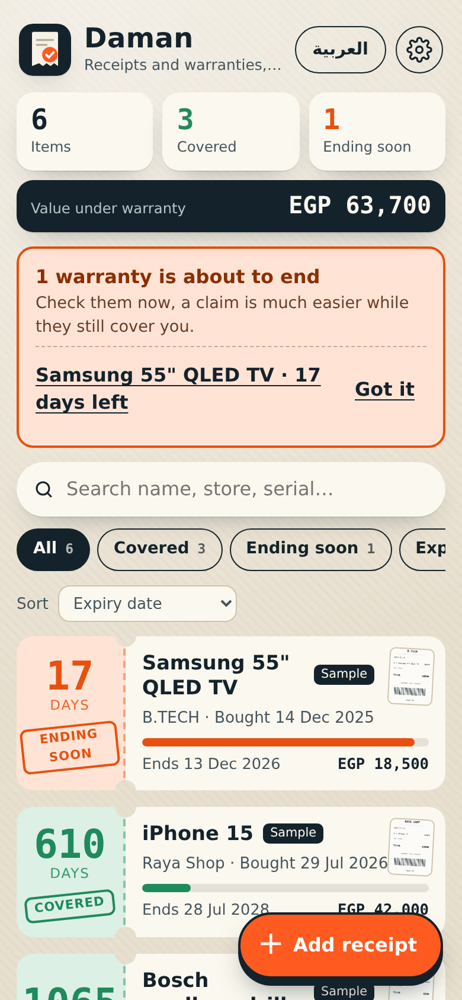
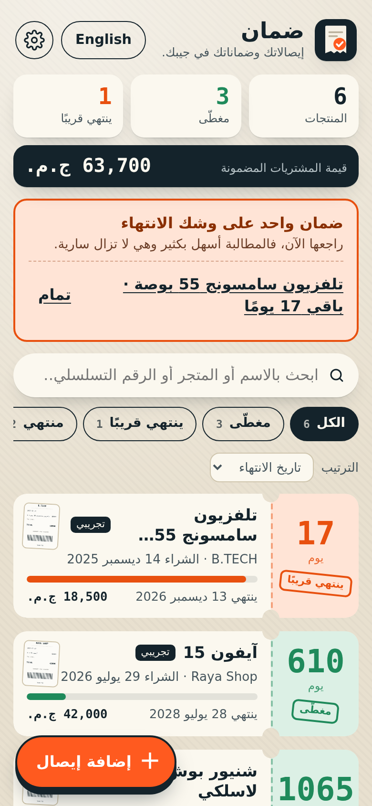
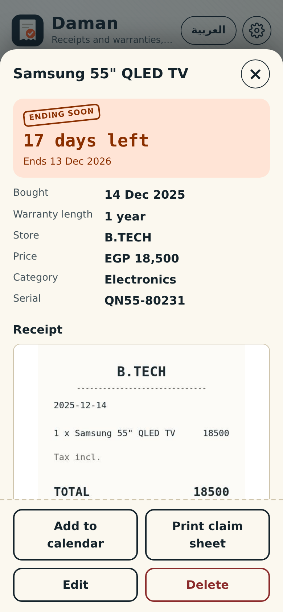
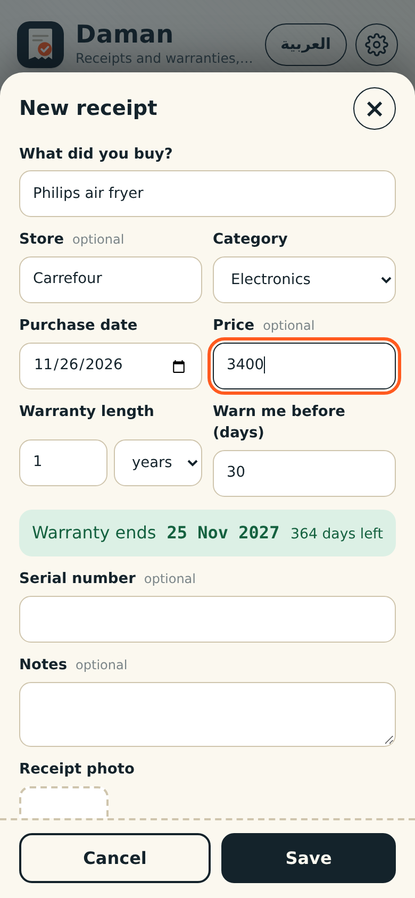
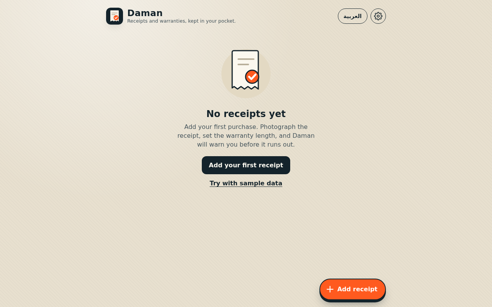
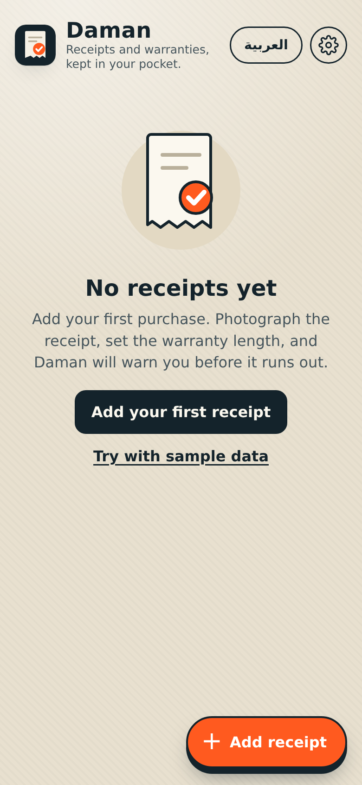

<p align="center"></p>

<h1 align="center">Daman | ضمان</h1>

<p align="center"><b>Receipts and warranties, kept in your pocket.</b><br>
A warranty and receipt vault that warns you before a warranty runs out.<br>
Arabic and English, right-to-left ready, mobile first.</p>

<p align="center"><a href="https://yousefkhames.github.io/daman/"><b>Open the live demo</b></a></p>

<p align="center">




</p>

## Screenshots

Captured from the live site (https://yousefkhames.github.io/daman/).

<p>
  
  
</p>

## The problem

The washing machine breaks in month 11, the receipt is somewhere in a drawer, and nobody remembers if the warranty was 12 or 24 months. Daman keeps the receipt photo, the purchase date and the warranty length together, counts the days for you, and nags you while a claim is still possible.

## Features

- **Receipt photos kept on the device.** Take or pick a photo, it is compressed and stored in the browser (IndexedDB). Nothing is uploaded anywhere.
- **Exact warranty math.** Purchase date plus months or years. The last covered day is the day before the anniversary, and month ends are handled (31 Jan plus 1 month is 28 Feb).
- **Three states at a glance.** Covered, ending soon, expired, each with a countdown stub, a progress bar and a stamp.
- **Alert before it ends.** Per item "warn me N days before". A banner shows items inside their window, you can dismiss each one, and optional browser notifications fire while the app is open.
- **Add to calendar.** Download an `.ics` file for the last warranty day with a reminder N days before. This is the alert that works even when the app is closed.
- **Claim sheet.** One tap prints a page with the product, store, serial, dates and the receipt photo to bring to the service center.
- **Search, filter, sort.** By name, store, serial or notes. Filter by covered, ending soon, expired. Sort by expiry, newest, name or price.
- **Backup and restore.** JSON backup including photos, CSV export for spreadsheets, restore that merges by item.
- **Arabic and English.** Full RTL layout, Arabic plural forms for days and months, switch any time.
- **Works offline.** A service worker caches the app after the first visit.
- **Sample data.** One tap loads six clearly marked sample items (with generated receipts) so you can try everything, and one tap erases them.

## Run it

It is plain HTML, CSS and JavaScript. No build step.

```sh
git clone https://github.com/yousefkhames/daman.git
cd daman
python3 -m http.server 8000   # or any static server, then open http://localhost:8000
```

## Tests

```sh
npm test                       # 19 unit tests: dates, status, search, CSV, ICS, backup, and matching English/Arabic strings (Node 18+)
npm i && npm run e2e           # real Chrome click-through, 51 checks (needs Chrome, set CHROME=/path if not in /usr/bin)
```

The browser test creates, edits, deletes, searches, switches to Arabic, uploads a photo, downloads and parses the `.ics`, exports and restores a backup, reloads to check persistence, and goes offline.

## How it is built

| Part | Choice |
| --- | --- |
| UI | Vanilla JavaScript, no framework, no dependencies at runtime |
| Logic | `core.js`, pure functions shared by the app and the unit tests |
| Data | `localStorage` for items and settings, IndexedDB for photos |
| Text | `i18n.js`, English and Arabic dictionaries, `dir` switches with the language |
| Offline | `sw.js` service worker |
| Hosting | Any static host. GitHub Pages is used for the demo |

## Honest limits

- **Your data lives in one browser on one device.** There is no account and no sync. Clearing site data, uninstalling the browser or using private mode erases it. Download a backup now and then.
- **GitHub Pages is a demo host.** For real use, keep your own backup or host a copy yourself.
- **Alerts are limited without a server.** Notifications only appear while Daman is open in a browser, there is no push when it is closed. Use the calendar export for reminders that reach you anyway.
- **Browser storage is finite.** Photos are shrunk to about 1400 px, but hundreds of receipts can hit the browser quota. Settings shows the usage.
- **No receipt scanning.** You type the product, date and warranty length yourself.
- **Dates use your device clock and calendar day.** The Gregorian calendar only.
- **Arabic text was not reviewed by a native editor yet.** Corrections are welcome.

## License

MIT, see [LICENSE](LICENSE).
